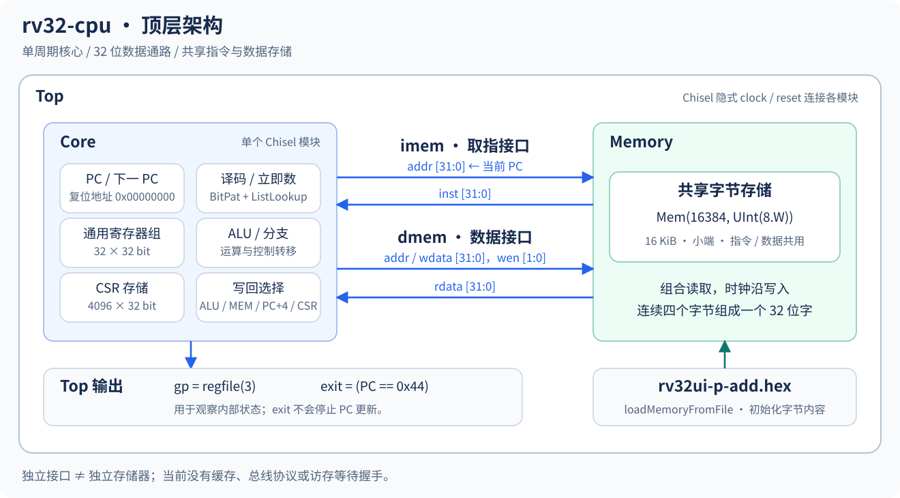
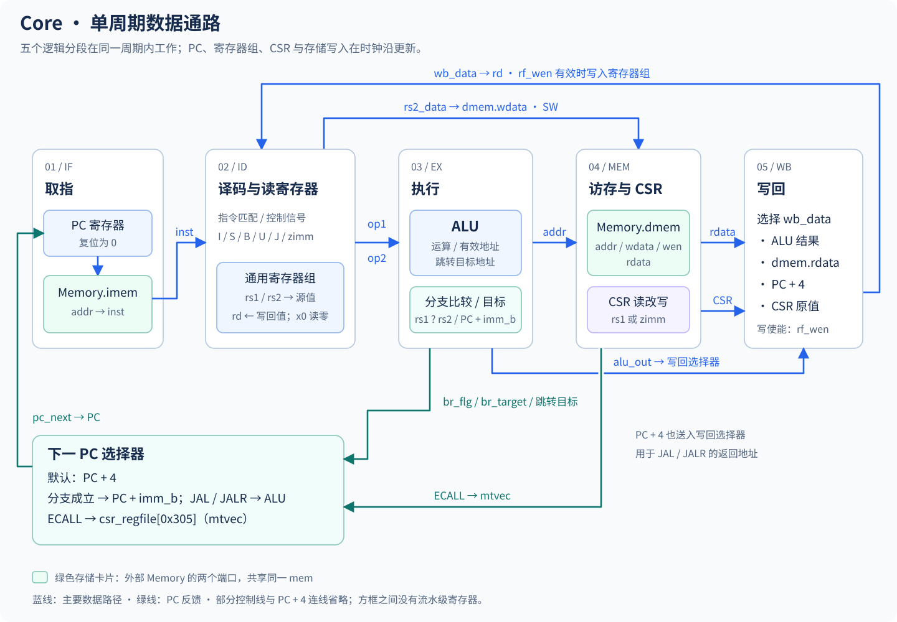

# rv32-cpu

使用 Chisel 实现的 32 位 RISC-V 单周期 CPU，面向处理器结构学习与仿真验证。当前实现 31 条基础整数指令、六条 CSR 访问指令，以及简化的 ECALL 处理路径。

项目已经具备模块测试、整机小程序测试，以及官方 riscv-tests 程序的镜像转换和批量回归流程。当前功能范围内的 10 项模块/顶层测试和选定的 32 项官方测试已有通过记录；这不代表完整 RV32I 或特权规范符合性。综合、时序分析与 FPGA 上板尚未验证。

## 快速开始

在项目根目录执行以下命令。

### 1. 编译与模块测试

```bash
sbt compile
sbt "testOnly memoryspec.MemorySpec corespec.CoreSpec topspec.TopSpec"
```

这三个套件使用 `src/test/resources/` 中的小型镜像，无需转换 prebuilt 中的官方测试程序。

### 2. 官方测试

项目已在 [`src/prebuilt/share/riscv-tests/isa/`](src/prebuilt/share/riscv-tests/isa/) 提供预编译的官方测试 ELF，可直接转换并运行，无需自行下载源码或重新编译测试程序。镜像转换仍使用 RISC-V GCC 工具链附带的 GNU binutils。`tohex.sh` 从中选择当前支持的 32 项测试；`.dump` 是反汇编文本，不作为转换输入。

这些 ELF 从地址 0 链接，配合当前 Core 的启动地址和 `PC==0x44` 退出约定。运行前仍需安装环境与依赖中列出的仿真工具和镜像转换工具。

```bash
# 转换全部 32 个选定程序：ELF → BIN → 每行一个字节的 HEX
./scripts/tohex.sh

# 逐个运行 sbt，并汇总结果
./scripts/riscv-tests.sh

# 也可以只转换、运行指定项
./scripts/tohex.sh add beq lw sw
./scripts/riscv-tests.sh add beq lw sw
```

转换生成的 `.bin` 和 `.hex` 位于 `src/riscv/`，由 Git 忽略，首次克隆后需要先执行 `tohex.sh`。每次批量运行的日志与 `summary.tsv` 位于独立的 `target/riscv-tests/run-*/` 目录。任何一项失败，脚本最终返回非零状态；单项失败不会阻止后续测试执行。

依赖检查、工具选择、测试白名单和文件格式详见 [脚本说明](scripts/README.md)。

## 环境与依赖

| 组件 | 当前项目配置 / 用途 |
| --- | --- |
| JDK | 已在 JDK 17 环境验证 |
| sbt | 1.12.4，由 `project/build.properties` 指定 |
| Scala | 2.13.18 |
| Chisel | 7.7.0，包含 ChiselSim 测试接口 |
| ScalaTest | 3.2.19 |
| Verilator 与 C++ 构建工具 | 用于 ChiselSim 仿真 |
| RISC-V GCC 工具链（含 GNU binutils） | 使用其中的 RISC-V `objcopy` 将 ELF 转为 BIN |

Scala、Chisel 和 ScalaTest 版本定义在 [build.sbt](build.sbt)。安装 RISC-V GCC 工具链后，将其 `bin/` 目录加入 PATH。以下以 `riscv64-unknown-elf-` 为例；该工具链的 objcopy 可以处理项目提供的 RV32 ELF：

```bash
# 确认工具链可用
riscv64-unknown-elf-gcc --version
riscv64-unknown-elf-objcopy --version

# 显式使用工具链中的 objcopy 转换项目提供的 ELF
OBJCOPY=riscv64-unknown-elf-objcopy ./scripts/tohex.sh
```

脚本默认依次查找 `riscv32-unknown-elf-objcopy`、`riscv64-unknown-elf-objcopy`、`riscv64-linux-gnu-objcopy`；也可以通过 `OBJCOPY` 指定工具的绝对路径。这里使用的是 GCC 工具链配套的二进制转换工具，不会调用 GCC 重新编译 prebuilt，也不需要 Spike。

## 项目结构

```text
rv32-cpu/
├── build.sbt
├── project/                         # sbt 配置
├── scripts/
│   ├── tohex.sh                     # 官方 ELF 转 BIN / HEX
│   ├── riscv-tests.sh               # 批量测试、日志与结果汇总
│   └── README.md
├── docs/images/                     # 顶层结构和数据通路图
├── src/
│   ├── main/scala/
│   │   ├── common/
│   │   │   ├── Consts.scala         # 位宽与控制信号编码
│   │   │   └── Instructions.scala   # 指令 BitPat 编码
│   │   └── rv32cpu/
│   │       ├── Core.scala           # 单周期核心
│   │       ├── Memory.scala         # 存储接口与共享存储器
│   │       └── Top.scala            # 核心与存储器的连接
│   ├── test/
│   │   ├── scala/                   # MemorySpec / CoreSpec / TopSpec / RiscvTests
│   │   └── resources/               # 模块及顶层测试使用的 HEX
│   ├── riscv/                       # 生成的 BIN / HEX，不纳入版本控制
│   └── prebuilt/                    # 随项目保留的预编译测试资源
│       └── share/riscv-tests/isa/    # 官方测试 ELF，脚本选择其中 32 项
└── target/                          # 构建、仿真及批量测试产物
```

建议按 `Top.scala` → `Memory.scala` → `Core.scala` 的顺序阅读；译码时对照 `Instructions.scala` 与 `Consts.scala`。

## 硬件结构



[Top](src/main/scala/rv32cpu/Top.scala) 实例化一个 Core 和一个 Memory。取指接口与数据接口相互独立，但访问同一块 16 KiB 存储器。当前没有缓存、总线仲裁、等待状态或 ready/valid 握手。

| 模块 | 职责 |
| --- | --- |
| Core | PC、通用寄存器堆、译码、立即数生成、ALU、分支、CSR 与写回 |
| Memory | 按字节寻址的小端存储，组合读、时钟沿写，支持 HEX 初始化 |
| Top | 连接两组存储接口，传递初始化文件和调试参数，导出观察信号 |

### 单周期数据通路



Core 按 IF、ID、EX、MEM、WB 分段组织代码，段间没有流水级寄存器。一条指令的组合逻辑在一个周期内完成，PC、寄存器写回以及存储器写入在时钟边沿更新。

| 阶段 | 当前工作 |
| --- | --- |
| IF | PC 驱动取指地址；默认下一 PC 为 PC+4，分支、跳转和 ECALL 可改变它 |
| ID | 提取 rs1、rs2、rd，读取寄存器，生成立即数，通过 ListLookup 产生控制信号 |
| EX | 算术、逻辑、移位、比较、地址计算，以及分支条件判断 |
| MEM | 连接数据访存接口，执行简化的 CSR 读改写 |
| WB | 从 ALU 结果、内存读数据、PC+4、CSR 原值中选择写回值 |

PC 复位为 `START_ADDR=0`。通用寄存器堆为 `Mem(32, UInt(32.W))`，源操作数读取 x0 时强制返回零，其他寄存器需要程序在使用前初始化。JAL/JALR 将旧 PC+4 写入 rd；JALR 将目标地址最低位清零。

### 存储器与镜像

Memory 使用 `Mem(16384, UInt(8.W))`，两个读端口均组合读取连续四个字节。数据写使能为 `MEN_S` 时，在时钟边沿写入四个字节；`MEN_X` 禁止写入。

```text
读取：{ mem[addr+3], mem[addr+2], mem[addr+1], mem[addr] }
写入：wdata[7:0] → mem[addr]，…，wdata[31:24] → mem[addr+3]
```

初始化文件可通过构造参数指定：

```scala
new Memory(initFile = "src/riscv/rv32ui-p-add.hex")
new Top(initFile = "src/riscv/rv32ui-p-add.hex")
```

默认 `initFile=""` 表示不加载文件，**不表示自动清零**。非空路径在电路展开时转成绝对路径；手动传入相对路径时，它相对于运行工具的工作目录解析。测试资源通过类路径定位，批量脚本传入绝对路径。

HEX 的每一行对应一个字节。例如指令 `0x00500193` 按顺序保存为四行 `93`、`01`、`50`、`00`。数据接口目前只支持整字 LW/SW，没有访问宽度选择或字节写掩码。

### CSR 与 ECALL

CSR 使用 `Mem(4096, UInt(32.W))` 保存。六条 CSR 指令支持写入、按位设置或清除，写回 rd 的是修改前的 CSR 值。读取 `mhartid`（0xF14）固定返回 0。

ECALL 将 `mcause`（0x342）设为 11，并跳转到 `mtvec`（0x305）保存的地址。当前没有完整的 CSR 权限和只读检查、写入抑制规则、CSR 复位状态、`mepc` 保存、`mstatus` 更新或 MRET 返回；`mtvec` 的模式位也未解释。因此这里是简化的系统指令支持。

## 指令范围

以下以 Core 实际译码表为准。

| 类别 | 已接入指令 |
| --- | --- |
| 加减 | ADD、ADDI、SUB |
| 逻辑 | AND、ANDI、OR、ORI、XOR、XORI |
| 移位 | SLL、SLLI、SRL、SRLI、SRA、SRAI |
| 比较 | SLT、SLTI、SLTU、SLTIU |
| 分支 | BEQ、BNE、BLT、BGE、BLTU、BGEU |
| 跳转 | JAL、JALR |
| 高位立即数 | LUI、AUIPC |
| 访存 | LW、SW |
| CSR | CSRRW、CSRRWI、CSRRS、CSRRSI、CSRRC、CSRRCI |
| 环境调用 | ECALL（简化实现） |

官方批量测试选择前八类的 31 项指令测试，加一项 `simple`，合计 32 项。CSR/ECALL 路径会被部分程序的启动和退出流程使用，但没有因此获得完整的特权行为覆盖。

`PCNT` 的编码和控制常量仍属于未接入 Core 的自定义指令预留，不计入已实现指令。

## 测试与调试

| 套件 | 数量 | 主要检查 |
| --- | --- | --- |
| `memoryspec.MemorySpec` | 4 | HEX 初始化、小端序与无时钟读、同步字写入、写禁止与地址隔离 |
| `corespec.CoreSpec` | 4 | PC 复位与顺序更新、x0 与寄存器写回、BEQ、JALR |
| `topspec.TopSpec` | 2 | 真实取指的小程序、成功/失败/超时判定 |
| `riscvtests.RiscTest` | 每次 1 个程序 | 在周期上限内到达退出位置，且 gp 为 1 |

CoreSpec 直接向 `io.imem.inst` 注入指令；TopSpec 和 RiscTest 实例化真实 Memory 并加载程序。小型镜像内容见 [测试资源说明](src/test/resources/README.md)。TopSpec 中的失败与超时程序用来验证判定机制必须抛出失败异常，因此该测试本身应当通过。

Top 的 `gp` 是 x3 当前值；`exit` 表示 PC 是否等于 `0x44`，不会自动停住 CPU。官方测试必须同时满足 `exit=true` 与 `gp=1` 才算成功。该约定依赖当前官方测试的链接布局，更换测试环境时需要重新核对。

直接运行一项官方测试：

```bash
# 默认加载 src/riscv/rv32ui-p-add.hex，需先生成镜像
sbt "testOnly riscvtests.RiscTest"

# 显式选择镜像
RISCV_HEX="$PWD/src/riscv/rv32ui-p-lw.hex" sbt "testOnly riscvtests.RiscTest"

# 调整周期上限，或开启逐周期日志
RISCV_MAX_CYCLES=20000 ./scripts/riscv-tests.sh lw sw
RISCV_DEBUG=true ./scripts/riscv-tests.sh add
```

默认周期上限为 10000，调试日志默认关闭。`RISCV_MAX_CYCLES` 必须是正的 Int，`RISCV_DEBUG` 接受 `true` 或 `false`。Scala 中也可以用 `new Core(debug = true)` 或 `new Top(initFile = "...", debug = true)` 开启日志。这个参数在生成电路时决定是否包含 printf，不是运行时硬件开关；gp 和 exit 始终保留。

`sbt test` 会包含 RiscTest，因此也要求默认 ADD 镜像已经存在。批量运行 32 项官方程序需要使用脚本，单独执行 `sbt test` 不会自动遍历所有 HEX。

## 当前限制

- 尚未实现 LB/LBU/LH/LHU/SB/SH、FENCE、EBREAK、乘除法和压缩指令等功能。
- 未识别指令采用默认控制值，通常继续 PC+4；没有非法指令异常。
- 尚无存储地址越界检查、对齐异常或完整特权状态管理。
- 单周期数据通路依赖组合读存储器；接入同步 RAM 或有等待周期的总线需要调整时序控制。
- 尚无独立的 RTL 导出入口、综合结果、时序报告或上板验证记录。

## 许可

MIT，见 [LICENSE](LICENSE)。
